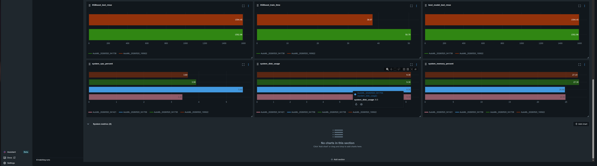

# AutoML проект: Прогнозирование цены автомобиля

**Студент:** Зайнуллин Венер
**Дисциплина:** Автоматизация машинного обучения
**Преподаватель:** Елена Смысловских

---

## Описание проекта

Сервис по продаже автомобилей с пробегом «Не бит, не крашен» разрабатывает приложение, чтобы привлечь новых клиентов. В нём можно будет узнать рыночную стоимость своего автомобиля.

Нужно построить модель, которая умеет определять рыночную стоимость. В распоряжении есть данные о технических характеристиках, комплектации и ценах других автомобилей.

Критерии, которые важны заказчику:
- качество предсказания;
- время обучения модели;
- время предсказания модели.

## Данные

Датасет содержит информацию об автомобилях:
- **Целевая переменная:** `price` (цена автомобиля)
- **Признаки:** модель, тип топлива, тип кузова, коробка передач, год регистрации, мощность и др.

## Архитектура ML-пайплайна

### ETL процесс:

1. **Extract:** Загрузка данных из CSV
2. **Transform:** Обработка пропусков, удаление выбросов, кодирование категориальных признаков, масштабирование
3. **Load:** Сохранение предобработанных данных и модели

### Структура проекта

```
business_applications_of_machine_learning/
├── config.yaml                  # Все параметры: данные, модель, MLflow
├── pyproject.toml               # Зависимости и конфигурация инструментов
├── Dockerfile                   # Multi-stage сборка с uv
├── docker-compose.yml           # train и predict сервисы
├── .pre-commit-config.yaml      # ruff, mypy, trailing-whitespace
│
├── src/
│   ├── config.py                # Pydantic-модели конфигурации
│   ├── logging_config.py
│   ├── data/
│   │   ├── loader.py            # load_data, normalize_columns
│   │   └── validation.py        # validate_raw_schema, validate_clean_data
│   ├── features/
│   │   ├── cleaning.py          # standardize_categories, clean_training_data
│   │   ├── pipeline.py          # create_preprocessor
│   │   ├── schema.py            # get_features_target, get_columns_types
│   │   ├── split.py             # split_data
│   │   └── transformers.py      # PowerImputer (без утечки)
│   ├── models/
│   │   ├── metrics.py           # rmse, evaluate_predictions
│   │   ├── persistence.py       # save_model, load_model
│   │   ├── registry.py          # MODEL_REGISTRY (XGB/LGBM/CatBoost/LinReg)
│   │   └── trainer.py           # train_single_model
│   ├── optimization/
│   │   └── optimize.py          # make_objective, run_study
│   ├── pipeline/
│   │   ├── prepare.py           # prepare_training_dataset
│   │   ├── train.py             # train_pipeline (оркестратор)
│   │   └── predict.py           # predict_from_file (inference)
│   └── tracking/
│       └── mlflow_utils.py      # init_mlflow, log_system_metrics
│
├── scripts/
│   ├── train.py                 # Entry point: обучение
│   └── predict.py               # Entry point: предсказание
│
└── tests/                       # pytest + mypy --strict
```

## AutoML реализация

Использована библиотека **Optuna** для байесовской оптимизации гиперпараметров:

| Модель | Параметры для оптимизации |
|--------|--------------------------|
| XGBoost | n_estimators, max_depth, learning_rate, subsample, reg_alpha, reg_lambda |
| CatBoost | iterations, depth, learning_rate, l2_leaf_reg, border_count |
| LightGBM | n_estimators, max_depth, learning_rate, num_leaves, subsample |

## Результаты

| Модель | RMSE (CV) | RMSE (Test) | MAE (Test) | R2 (Test) |
|--------|---------|-------------|-----------|-----------|
| LinearRegression | 2858.861 | 2858.861 | 2004.157 | 0.613 |
| CatBoost | 1623.691 | 1606.375 | 1002.014 | 0.878 |
| XGBoost | 1610.787 | 1591.178 | 984.421 | 0.880 |
| LightGBM | 1619.913 | 1601.488 | 1008.224 | 0.879 |

**Лучшая модель:** XGBoost с RMSE 1610.787

## Итоговое заключение

Разработанная модель XGBoost готова к внедрению в сервис «Не бит, не крашен». Она позволяет автоматически оценивать рыночную стоимость автомобиля с ошибкой около 1600 евро (R² = 0.88). Модель предсказывает цену за доли секунды и может обрабатывать тысячи запросов одновременно.

Рекомендуется: запустить модель в тестовом режиме на 10% трафика, собрать обратную связь и через месяц дообучить модель на новых данных. При положительных результатах — масштабировать на весь сервис.

---

## Требования

- Python ≥ 3.12
- [uv](https://docs.astral.sh/uv/) — менеджер пакетов и окружений
- Docker + Docker Compose (для запуска в контейнере)

## Установка

```bash
git clone <repo-url>
cd business_applications_of_machine_learning
uv sync
```

> Зависимости управляются через `uv` (см. `pyproject.toml` и `uv.lock`).
> `requirements.txt` не используется — для legacy-инструментов сгенерируйте
> его через `uv export --format requirements-txt`.
>
Все параметры (пути, гиперпараметры, MLflow-эксперимент) хранятся в `config.yaml` и валидируются через Pydantic при старте. Дефолтные значения — в `src/config.py`.

## Обучение

```bash
uv run python scripts/train.py
```

Что происходит:

1. Загрузка и валидация данных из `data/autos.csv`
2. Очистка (выбросы, дубликаты), унификация категорий
3. Train/test split (стратифицированно по `config.yaml`)
4. Optuna подбирает гиперпараметры для XGBoost, LightGBM, CatBoost
5. Метрики и артефакты логируются в MLflow
6. Лучший пайплайн сохраняется в `models/best_model_pipeline.joblib`

## Предсказание

```bash
uv run python scripts/predict.py \
    --input data/autos.csv \
    --output preds.csv
```

Если в input есть колонка `price` — в результат попадёт `actual_price` для batch-валидации. Если нет — только `predicted_price`. Строки **не удаляются**: сколько пришло — столько и вернётся.

## Мониторинг

```bash
uv run mlflow ui
```

- **MLflow:** логирование метрик, параметров и артефактов
- **Системные метрики:** CPU, RAM, диск (psutil)
- **Время обучения:** замеряется для каждой модели




## Docker

Сборка:

```bash
docker build -t car-price-ml .
```

Обучение:

```bash
docker run --rm \
    -v $(pwd)/data:/app/data \
    -v $(pwd)/models:/app/models \
    -v $(pwd)/mlruns:/app/mlruns \
    car-price-ml
```

Предсказание:

```bash
docker run --rm \
    -v $(pwd)/data:/app/data \
    -v $(pwd)/models:/app/models \
    car-price-ml scripts.predict --input /app/data/autos.csv --output /app/preds.csv
```

Или через `docker-compose`:

```bash
docker compose run --rm train
docker compose run --rm predict
```

## Разработка

```bash
# Линтер и форматтер
uv run ruff check src tests
uv run ruff format src tests

# Проверка типов
uv run python -m mypy src tests

# Тесты
uv run pytest tests/ -v

# Все проверки разом
uv run pre-commit run --all-files
```

CI (GitHub Actions) прогоняет эти же команды на каждый push в `main` и на PR. Конфигурация — в `.github/workflows/ci.yml`.
